# AEGIS 统一权限中枢

> 企业级统一身份与权限管理平台（IAM / UPMS） · 私有化部署 · 闭源商业软件
>
> 当前版本：**v1.0.0**（2026-10-12）

AEGIS 把散落在各业务系统中的**用户、组织、角色、权限**收拢到一个中枢统一管理，对外提供登录认证、单点登录（OAuth2 / OIDC 简化）、统一鉴权决策（Casbin RBAC + 数据范围）与全量审计能力。业务系统接入后不再自建用户体系，也不再各自实现权限判断。

**本仓库只存放产品文档与发行包（Releases），不包含源代码。** 软件为闭源商业产品，通过 GitHub 分发安装包仅为便于交付与版本管理。

**产品官网**：<https://apps-hub.apphola.com/>

**文档中心**：<https://docs.apphola.com/>

**仓库地址**：<https://github.com/apphola-com/sec-iam>

**下载地址**：<https://github.com/apphola-com/sec-iam/releases>

---

## 目录

- [一、产品概览](#一产品概览)
- [二、功能清单](#二功能清单)
- [三、快速部署](#三快速部署)
- [四、管理员操作](#四管理员操作)
- [五、应用接入](#五应用接入)
- [六、单点登录](#六单点登录)
- [七、接口错误码](#七接口错误码)
- [八、运维与安全](#八运维与安全)
- [九、常见问题](#九常见问题)
- [十、版本记录](#十版本记录)
- [十一、许可与支持](#十一许可与支持)

---

## 一、产品概览

### 1.1 定位

AEGIS 是独立于所有业务系统存在的**统一身份与授权基础设施**。它不承载具体业务，只做四件事：

1. **唯一身份源**：用户与组织只在中枢维护，业务系统只保存 `user_id` 引用；
2. **统一认证**：账号密码登录、单点登录（OAuth2 授权码模式）、会话管理；
3. **统一授权**：基于 Casbin 的 RBAC 决策，叠加数据范围（行级）约束，向业务系统输出「允许 / 拒绝 / 可见范围」；
4. **统一审计**：登录、操作、权限变更全量留痕，并支持完整性校验。

### 1.2 解决的问题

| 现状问题 | AEGIS 的做法 |
| --- | --- |
| 每个系统自建账号，员工离职后账号残留 | 中枢统一建档与冻结，全局唯一身份 |
| 组织架构多套口径，统计对不上 | 一棵组织树，全系统共用 |
| 权限判断散落在各系统代码里，改权限要发版 | 权限点集中建档，授权后即时生效 |
| 谁给谁开了什么权限，事后查不清 | 权限变更日志 + 定期复核 + 高风险报表 |
| 有菜单权限就能看全公司数据 | 数据范围四档下沉到接口层 |
| 多系统重复登录 | 一次登录，SSO 全通 |
| 内网无法联网拉取依赖 | 全离线 Docker 镜像包，一条命令部署 |

### 1.3 设计原则

- **私有化单实例**：面向集团内部部署，非 SaaS、非多租户，用组织树表达层级。
- **三权分立**：超级管理员、安全管理员、审计管理员职责分离。
- **默认拒绝**：受管控接口未显式授权即拒绝；未纳管接口放行，避免影响存量系统。
- **权限码即契约**：`项目编码:资源:操作` 是中枢与业务系统间唯一的权限语义。
- **敏感逻辑留在服务端**：前端只做展示与交互，判定一律由后端完成。
- **可离线交付**：镜像、密钥、数据全部本地化，不依赖外部服务。

### 1.4 总体架构

```
                     ┌──────────────────────────────────────────┐
                     │              浏览器（管理员 / 用户）        │
                     └───────────────┬──────────────────────────┘
                                     │ HTTPS
                     ┌───────────────▼──────────────────────────┐
                     │  frontend（nginx）                        │
                     │  · 托管管理控制台 SPA                      │
                     │  · /api 同源反代 → backend（免 CORS）      │
                     └───────────────┬──────────────────────────┘
                                     │
      ┌──────────────────────────────▼───────────────────────────────┐
      │  backend（Go / Gin）                                          │
      │  ┌────────────┬────────────┬────────────┬──────────────────┐  │
      │  │ 认证 Auth   │ 授权 Authz │ 管理 Admin │ 开放 Open API    │  │
      │  │ JWT/会话    │ Casbin     │ 组织/用户   │ 鉴权 check       │  │
      │  │ OAuth2 SSO  │ 数据范围    │ 角色/权限点 │ 权限点自注册      │  │
      │  └────────────┴────────────┴────────────┴──────────────────┘  │
      │  中间件：JWT 认证 · Casbin 授权 · 操作审计 · 审计哈希链          │
      └───────────────┬──────────────────────────────┬───────────────┘
                      │                              │
            ┌─────────▼─────────┐          ┌─────────▼─────────┐
            │  MySQL 8（数据）   │          │  接入业务系统       │
            │  用户/组织/角色/   │          │  CRM / ERP / OA…  │
            │  权限/审计/策略    │          │  服务端调用鉴权接口  │
            └───────────────────┘          └───────────────────┘
```

关键点：

- 中枢同时是 **IdP（身份提供方）** 与 **PDP（策略决策点）**，业务系统是 **RP（依赖方）** 与 **PEP（策略执行点）**；
- 管理面走 JWT 认证，开放面走 AppKey + HMAC 签名，两套凭据互不混用；
- 前端经 nginx 与后端同源部署，SSO 回调与 API 调用无需处理跨域。

### 1.5 技术规格

| 项 | 说明 |
| --- | --- |
| 后端 | Go 1.26 · Gin · GORM · Casbin v2（gorm-adapter） |
| 前端 | React 19 · TypeScript · Redux Toolkit · reactstrap（Velzon 模板） |
| 数据库 | MySQL 8.0（utf8mb4） |
| 认证 | JWT Access Token（60 分钟）+ Refresh Token（可撤销） |
| 密码存储 | bcrypt；强度要求：≥ 8 位且含大小写字母与数字 |
| 单点登录 | OAuth2 授权码模式（OIDC 简化），授权码 5 分钟一次性 |
| 应用鉴权 | AppKey + HMAC-SHA256 + 时间窗 ±300s + nonce 防重放 + 100 次/秒限流 |
| 部署 | Docker Compose，单实例，linux/amd64 镜像 |
| 代码保护 | 后端 garble 混淆 + 符号裁剪；前端 Terser 压缩混淆 |
| 外部依赖 | 运行时零外网依赖（离线镜像包交付） |

### 1.6 编码体系

| 对象 | 规则 | 示例 |
| --- | --- | --- |
| 平台代号 | 固定 | `AEGIS` |
| 中枢自身项目 | `APP-SEC-IAM-001` | 安全域 / IAM 系统 / 序号 001 |
| 接入项目 | `APP-业务域-系统-序号` | `APP-SALE-CRM-001` |
| 端类型 | 项目编码 + 端类型码 | `APP-SALE-CRM-001-WEB` |
| 权限点 | `项目编码:资源:操作` | `APP-SALE-CRM-001:customer:update` |
| 部署实例 | `AEGIS-客户简称-序号` | `AEGIS-ABC-001` |

> 权限点前缀必须与项目编码一致，中枢在后端强校验；跨应用编码会被整批拒绝。

---

## 二、功能清单

### 2.1 功能总览

| 模块 | 菜单路径 | 核心能力 |
| --- | --- | --- |
| 控制台 | 控制台 | 组织 / 用户 / 角色 / 权限点总览，最近登录与操作日志 |
| 组织架构 | 组织架构 | 四级组织树增删改、排序、层级查询 |
| 用户管理 | 用户管理 | 账号 CRUD、冻结 / 恢复、重置密码、绑定角色、数据范围、强制改密 |
| 角色管理 | 角色管理 | 三权分立内置角色 + 自定义角色、按权限点授权 |
| 权限点管理 | 权限点管理 | 菜单 / 按钮 / API 三类权限点树，按应用筛选 |
| 应用管理 | 应用管理 | 应用注册、密钥查看与重置、对接文档导出、OAuth 客户端配置 |
| 权限映射中心 | 权限映射中心 | 业务角色 × 应用授权模板、预览、同步、撤销、启停、同步日志 |
| 我的申请 | 我的申请 | 提交 / 撤回角色授权申请，查看进度 |
| 权限审批 | 权限审批 | 待审批列表、批准 / 拒绝 |
| 权限治理 | 权限治理 | 权限模拟、孤儿权限、定期复核、日志防篡改、智能建议 |
| 合规报表 | 合规报表 | 用户权限总览、角色成员统计、高风险权限、审计导出 |
| 异常告警 | 异常告警 | 告警列表与处理闭环 |
| 会话管理 | 会话管理 | 在线会话查看、强制下线 |
| 审计日志 | 审计日志 | 登录日志、操作日志、权限变更日志 |
| 接入申请 | 接入申请 | 自助提交应用接入申请，审批后自动发凭据 |
| 个人信息 | 个人信息 | 本人资料、修改密码 |

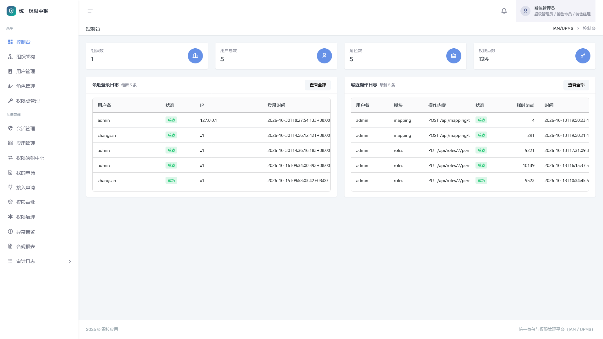

> 图：控制台首页

### 2.2 组织与用户

**组织架构**

- 覆盖集团 / 公司 / 部门 / 团队，邻接表存储，支持任意层级；
- 组织 ID 是数据范围的基准，用户主组织决定其"本组织"边界；
- 删除限制：存在下级组织，或组织下存在用户时不可删除，需先迁移。

**用户管理**

| 能力 | 说明 |
| --- | --- |
| 新建账号 | 用户名、真实姓名、主组织、初始密码、是否强制首登改密 |
| 冻结 / 恢复 / 离职 | 冻结与离职立即禁止登录并拒绝鉴权，审计链路保留 |
| 重置密码 | 重置后标记"下次登录必须改密" |
| 绑定角色 | 一次可勾选多个角色，统一设置所属组织与数据范围；重新绑定会覆盖原角色 |
| 删除账号 | 物理删除并清理角色绑定；内置 `admin` 不可删除、不可冻结 |

数据范围四档：

| 值 | 含义 | 典型场景 |
| --- | --- | --- |
| 1 | 全部数据 | 集团管理层、超管 |
| 2 | 本组织及下级 | 区域负责人、部门主管 |
| 3 | 仅本组织 | 部门内勤 |
| 4 | 仅本人 | 一线业务员 |

> 多角色绑定时取**最宽**范围；实际过滤以接口返回的 `visible_org_ids` 为准。

### 2.3 角色与权限点

**内置角色（三权分立）**

| 角色编码 | 名称 | 职责 |
| --- | --- | --- |
| `super_admin` | 超级管理员 | 全量权限，跳过 Casbin 判定 |
| `security_admin` | 安全管理员 | 用户、角色、权限点、应用、会话、审批、治理等 |
| `audit_admin` | 审计管理员 | 审计、报表、告警、治理为主，不参与用户与授权配置 |

- 内置角色不可修改、不可删除；自定义角色按应用权限点自由组合；
- 授权保存后即时同步 Casbin 策略，无需重启；
- 删除自定义角色会清理其权限点关联，残留的用户绑定可由「权限治理 → 孤儿权限」发现并清理。

**权限点三类**

| 类型 | 值 | 用途 |
| --- | --- | --- |
| 菜单 | 1 | 控制菜单可见性 |
| 按钮 | 2 | 控制页面内操作按钮 |
| API | 3 | **进入 Casbin 策略，参与接口鉴权** |

> 给接入应用建档时必须选 **API**，否则会出现"建档成功但鉴权恒拒绝"。

### 2.4 应用、映射与审批

**应用管理**

- 注册应用：项目编码、名称、负责人、SSO 回调地址；
- 凭据：注册即生成 AppKey / AppSecret 与 `client_id` / `client_secret`；
- 密钥采用明文 + SHA-256 哈希双存，鉴权走哈希，明文供管理端回读与导出；
- 导出对接信息（Markdown，可选包含密钥，需权限并记审计）；
- 重置密钥、启停应用、删除应用（建议优先停用）。

**权限映射中心**

面向"角色模板化 + 多应用"场景：维护「业务角色 × 应用」授权模板，支持预览（不落库）、同步、撤销、启停与同步日志，避免逐条授权。

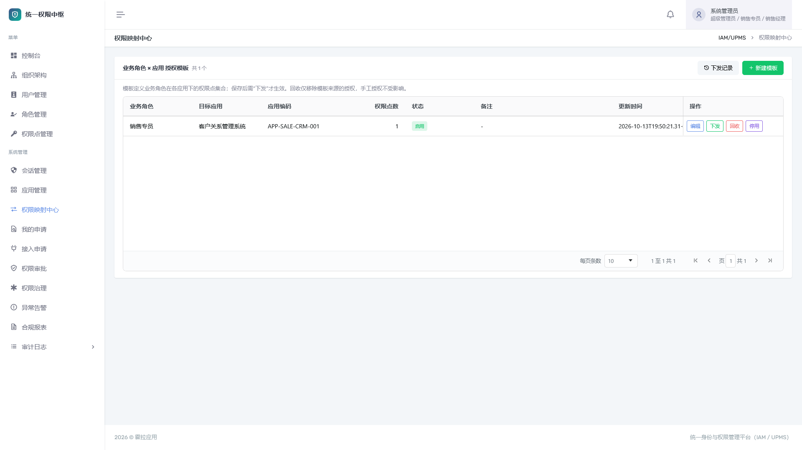

> 图：权限映射中心

**申请与审批**

| 流程 | 申请人入口 | 审批入口 | 审批组 | 批准后效果 |
| --- | --- | --- | --- | --- |
| 角色授权申请 | 我的申请 | 权限审批 | 超管 / 安全管理员 | 自动绑定角色与数据范围 |
| 应用接入申请 | 接入申请 → 我的接入申请 | 接入申请 → 接入审批 | 超管 / 安全管理员 | 自动建应用 + OAuth 客户端，凭据一次性返回 |

- 待审批单可撤回；拒绝必须填写理由；
- 批准动作写入权限变更日志，可追溯。

### 2.5 治理、审计与告警

**权限治理**

| 子功能 | 说明 |
| --- | --- |
| 权限模拟 | 选择用户 + 应用，查看实际生效的权限点及来源角色 |
| 孤儿权限 | 扫描已删除角色 / 用户残留的无效授权，确认后清理 |
| 定期复核 | 按周期列出超期未复核的授权，批量标记已复核 |
| 日志防篡改 | 校验审计日志哈希链，断链即告警 |
| 智能建议 | 长期未使用权限回收、超期未复核收敛提示 |

**审计日志**

| 日志 | 内容 |
| --- | --- |
| 登录日志 | 账号、IP、UA、结果、失败原因（成功与失败均记录） |
| 操作日志 | 操作人、方法、路径、状态码、耗时（仅写请求，含 403 被拒） |
| 权限变更日志 | 变更对象、变更前后、操作人 |

三类日志均带哈希链，前端不提供修改与删除入口。

**异常告警**

| 规则 | 阈值 | 级别 |
| --- | --- | --- |
| 登录失败异常 | 10 分钟内同一用户名失败 ≥ 5 次（≥ 10 次升级） | 警告 / 严重 |
| 越权尝试异常 | 1 小时内同一用户鉴权被拒 ≥ 20 次 | 严重 |

**会话管理**：查看在线会话（用户、IP、登录时间），支持强制下线。

### 2.6 能力边界（v1.0.0）

| 已具备 | 暂不支持 |
| --- | --- |
| 单实例私有化部署 | 多活 / 集群、跨机房容灾 |
| 账号密码 + OAuth2 SSO | MFA、扫码登录、外部 IdP（LDAP / AD / 企业微信 / 钉钉） |
| 组织树 + 数据范围四档 | 字段级权限、自定义 ABAC 表达式 |
| 应用级 API 鉴权与自注册 | 第三方应用市场、计量计费 |
| 审计日志 + 哈希链校验 | 日志外送 SIEM（可自行对接） |
| 权限申请与接入审批 | 自定义多级审批流编排 |
| OAuth2 授权码模式 | SAML2、CAS、完整 OIDC（无发现文档与 id_token） |

---

## 三、快速部署

### 3.1 部署形态

发布包为**离线 Docker 镜像包**，目标机无需外网、无需 Go / Node：

```
发布包（GitHub Releases）                    目标机
┌──────────────────────────┐             ┌──────────────────────────────┐
│ images/backend.tar       │             │ deploy.ps1 / deploy.sh       │
│ images/frontend.tar      │  解压执行    │   ├─ docker load 三个镜像     │
│ images/mysql_8.0.tar     │ ─────────>  │   ├─ 生成 .env（随机密钥）     │
│ docker-compose.yml       │             │   └─ docker compose up -d     │
│ deploy.ps1 / deploy.sh   │             │ mysql + backend + frontend   │
└──────────────────────────┘             └──────────────────────────────┘
```

| 容器 | 镜像 | 作用 | 默认端口（宿主机） |
| --- | --- | --- | --- |
| `aegis-mysql` | `mysql:8.0` | 数据持久化（卷 `mysql_data`） | 3307 → 3306 |
| `aegis-backend` | `aegis-iam/backend:<版本>` | 中枢 API 服务 | 8080 |
| `aegis-frontend` | `aegis-iam/frontend:<版本>` | nginx 托管控制台 + `/api` 同源反代 | 3000 → 80 |

### 3.2 前置条件

| 项 | 要求 |
| --- | --- |
| Docker | Docker Desktop 或 Docker Engine 20.10+，含 compose v2 插件 |
| 操作系统 | Linux x86_64（推荐生产）/ Windows 10+ / macOS（Docker Desktop） |
| CPU / 内存 | 2 核 / 4 GB 起，推荐 4 核 / 8 GB |
| 磁盘 | ≥ 10 GB 可用 |
| 端口 | 3000、8080、3307 未被占用（可改） |
| 网络 | **部署与运行均无需外网** |

> 镜像仅提供 `linux/amd64`；ARM 设备依赖模拟层，生产建议使用 x86_64 服务器。

### 3.3 安装步骤

从 [Releases](https://github.com/apphola-com/sec-iam/releases) 下载 `aegis-iam-docker-v<版本>.zip`（约 285 MB）并解压：

```
aegis-iam-docker-v<版本>/
├── images/                  # 离线镜像 tar（backend / frontend / mysql）
├── docker-compose.yml
├── .env.example
├── deploy.ps1               # Windows 一键部署
├── deploy.sh                # Linux / macOS 一键部署
└── BUILD-INFO.txt           # 版本 / 构建时间 / 混淆方式 / 镜像清单
```

**Windows（PowerShell 7+）**

```powershell
cd aegis-iam-docker-v<版本>
./deploy.ps1
```

**Linux / macOS**

```bash
cd aegis-iam-docker-v<版本>
chmod +x deploy.sh
./deploy.sh
```

脚本依次完成：加载三个离线镜像 → 无 `.env` 时生成（随机 MySQL 密码 + 随机 JWT 密钥）→ `docker compose up -d`（MySQL 健康后启动后端）。

**手工部署（可选）**

```bash
docker load -i images/mysql_8.0.tar
docker load -i images/aegis-iam_backend_<版本>.tar
docker load -i images/aegis-iam_frontend_<版本>.tar

cp .env.example .env
# 编辑 .env：AEGIS_IMAGE_TAG / AEGIS_MYSQL_PASSWORD / AEGIS_JWT_SECRET / AEGIS_CONSOLE_URL
docker compose up -d
```

### 3.4 首次启动与验证

首次启动后端会自动建库（AutoMigrate）、写入种子数据、重建 Casbin 策略，约 **1~2 分钟**。就绪标志：

```bash
docker logs aegis-backend
# 出现：AEGIS 权限中枢服务启动: http://0.0.0.0:8080
```

验证清单：

| 检查项 | 期望结果 |
| --- | --- |
| `docker compose ps` | 三个容器 `Up`，mysql 为 `healthy` |
| `curl http://localhost:8080/api/health` | 返回 `code=0` |
| `curl http://localhost:3000/api/health` | 与上一行一致（nginx 反代正常） |
| 浏览器访问 http://localhost:3000 | 出现登录页 |
| http://localhost:8080/swagger/index.html | Swagger UI 可访问 |

**默认账号**

| 用户名 | 默认密码 | 角色 | 说明 |
| --- | --- | --- | --- |
| `admin` | `Admin@123456` | 超级管理员 | 全量权限，首登强制改密 |
| `secadmin` | `Admin@123456` | 安全管理员 | 演示三权分立 |
| `auditadmin` | `Admin@123456` | 审计管理员 | 只读类账号 |

> **生产环境必须**：修改全部默认口令、按实际访问地址设置 `AEGIS_CONSOLE_URL`、收敛端口暴露。
> 种子数据包含一个 CRM 接入示例应用，其凭据在首次启动日志中打印一次（`docker logs aegis-backend`）。

### 3.5 端口与环境变量

| 变量 | 默认 | 必填 | 说明 |
| --- | --- | --- | --- |
| `AEGIS_IMAGE_TAG` | 版本号 | 是 | 与 `images/` 内 tar 一致，勿改 |
| `AEGIS_WEB_PORT` | 3000 | 否 | 控制台端口 |
| `AEGIS_BACKEND_PORT` | 8080 | 否 | API 端口 |
| `AEGIS_MYSQL_PORT` | 3307 | 否 | MySQL 宿主机端口 |
| `AEGIS_MYSQL_PASSWORD` | 随机 | 是 | 数据库 root 密码 |
| `AEGIS_JWT_SECRET` | 随机 | 是 | JWT 签名密钥，更换使全体会话失效 |
| `AEGIS_CONSOLE_URL` | `http://localhost:3000` | 是 | 控制台对外绝对地址，**SSO 跳转依赖它** |
| `AEGIS_SWAGGER` | `1` | 否 | 设为 `0` 关闭 Swagger |
| `AEGIS_AUTHZ_PLAIN` | 关闭 | 否 | 设为 `1` 开启鉴权简单模式，**仅联调，生产禁用** |

> 与开发环境同机部署时，3000/8080/3307 可能冲突，改为 3010/8090/3308 等，并同步修改 `AEGIS_CONSOLE_URL`。

### 3.6 升级、备份与卸载

```bash
docker compose ps                      # 状态
docker compose logs -f backend         # 跟踪后端日志
docker compose down                    # 停止（数据保留）
docker compose down -v                 # 停止并清空数据（危险）
```

**升级**：解压新版本包 → `docker load` 新镜像 → 更新 `.env` 中 `AEGIS_IMAGE_TAG` → `docker compose up -d`。数据库自动迁移，旧数据卷沿用。**升级前先备份数据卷。**

**备份 / 恢复**

```bash
# 备份（卷名以 docker volume ls 实际结果为准）
docker run --rm -v <项目名>_mysql_data:/data -v $(pwd):/backup alpine \
  tar czf /backup/mysql_data_$(date +%F).tgz /data

# 恢复（先 docker compose down）
docker run --rm -v <项目名>_mysql_data:/data -v $(pwd):/backup alpine \
  sh -c "rm -rf /data/* && cd / && tar xzf /backup/mysql_data_YYYY-MM-DD.tgz"
docker compose up -d
```

**卸载**：`docker compose down -v` 后按需删除镜像。

### 3.7 部署常见问题

| 现象 | 原因与处理 |
| --- | --- |
| 卡在 mysql waiting | 首次初始化较慢（30s+），`docker logs aegis-mysql` 查看进度 |
| 后端反复重启 | 多为 MySQL 未就绪或 `.env` 缺变量，看 `docker logs aegis-backend` |
| 页面能开但登录 502 | 后端仍在建库，等待「服务启动」日志 |
| 登录页报 OAuth 错误 | `AEGIS_CONSOLE_URL` 与实际访问地址不一致 |
| 端口被占用 | 修改三个端口并同步 `AEGIS_CONSOLE_URL` |
| `docker load` 报 no space | 磁盘不足，需 ≥ 10 GB |
| Windows 脚本被拦截 | 使用 PowerShell 7+，或 `powershell -ExecutionPolicy Bypass -File ./deploy.ps1` |

---

## 四、管理员操作

### 4.1 首次上手清单

| # | 任务 | 菜单 | 完成标志 |
| --- | --- | --- | --- |
| 1 | 修改默认口令 | 个人信息 | 三个内置账号均已完成首登改密 |
| 2 | 建组织树 | 组织架构 | 集团 → 公司 → 部门 → 团队 层级完整 |
| 3 | 建管理员账号 | 用户管理 | 安全管理员、审计管理员已分配真人账号 |
| 4 | 检查权限点 | 权限点管理 | 中枢自身权限点齐全（种子已内置） |
| 5 | 建业务角色 | 角色管理 | 每个业务岗位有对应角色 |
| 6 | 建业务用户并授权 | 用户管理 | 用户可登录，且只看到该看的数据 |
| 7 | 接入业务系统 | 应用管理 | 应用启用，凭据已交付接入方 |
| 8 | 验证审计 | 审计日志 | 能看到上述操作的完整记录 |

### 4.2 登录与口令

- 访问 `http://<部署地址>:3000`，输入用户名与密码；
- 首次登录（或管理员重置后）会强制进入改密页，改密后方可使用；
- 密码要求：**至少 8 位，且必须同时包含大写字母、小写字母与数字**，不得与原密码相同；
- 系统不提供自助找回，忘记密码由超管在 **用户管理 → 重置密码** 处理。

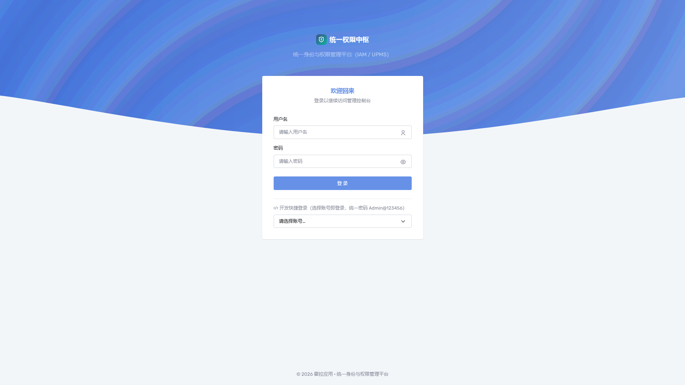

> 图：登录页

### 4.3 组织架构

1. 左侧树选中父节点（顶级为"集团"）；
2. **新增**，填写名称、编码、类型（集团 / 公司 / 部门 / 团队）、排序；
3. 编辑可改名称、类型、排序；**调整上级组织会改变其下所有用户的可见范围**；
4. 删除限制：有下级组织 → "存在下级组织，无法删除"；有用户 → 需先迁移用户。

| 场景 | 操作 |
| --- | --- |
| 部门合并 | 先把人员迁到目标组织，再删除空组织 |
| 新设子公司 | 在公司层级下新增，分配管理员并授权"本组织及下级" |
| 组织改名 | 直接编辑名称，编码保持不变（被外部引用时尤其注意） |

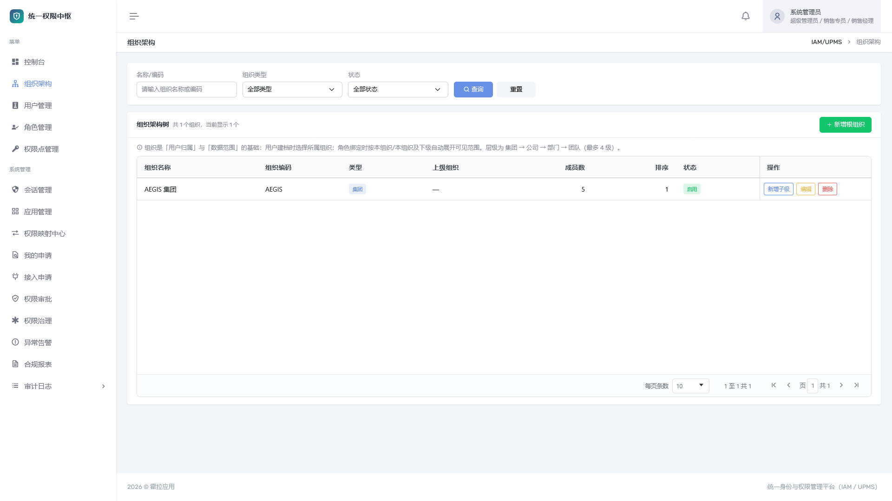

> 图：组织架构

### 4.4 用户管理

1. **新增用户**：用户名（登录名，创建后不建议修改）、真实姓名、所属组织、初始密码，默认勾选首登强制改密；
2. **状态管理**：冻结 / 恢复 / 离职 / 删除；冻结与离职立即生效，删除不可恢复；
3. **重置密码**：重置后该账号下次登录必须改密，请通过安全渠道告知本人；
4. **绑定角色**：勾选角色 → 选择所属组织（数据范围基准）→ 选择数据范围 → 保存。

> 重新绑定会**覆盖原有角色**；一次绑定中的所有角色共用一个组织与数据范围。
> 管理员自身也受数据范围约束，实施时请为管理员分配覆盖其职责的组织范围。

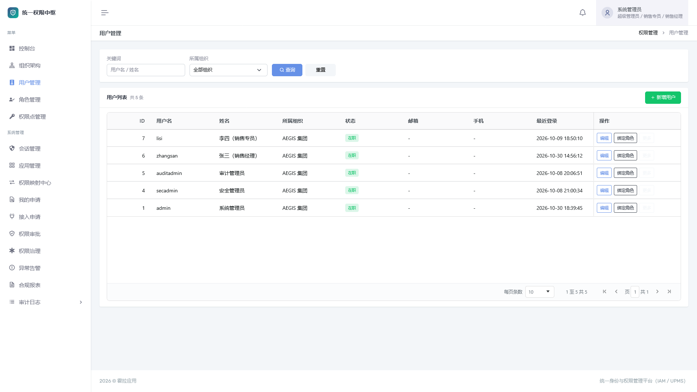

> 图：用户管理

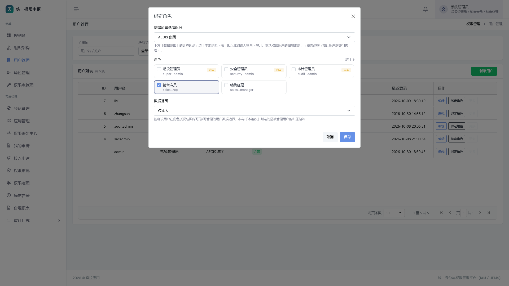

> 图：绑定角色与数据范围

### 4.5 角色与授权

1. **新增角色**：编码（小写下划线，如 `sales_manager`）、名称、备注；
2. 列表中 **分配权限**，按"所属应用"分组勾选权限点，保存后即时生效；
3. 授权原则：
   - 角色按岗位设计，不按人设计，人员变动只调绑定；
   - 一个角色可同时持有中枢与多个应用的权限点；
   - 敏感权限（删除、审批、密钥重置）单独建角色；
   - 角色编码一旦被接入方引用（SSO `roles`、按角色找人），不要随意改名。

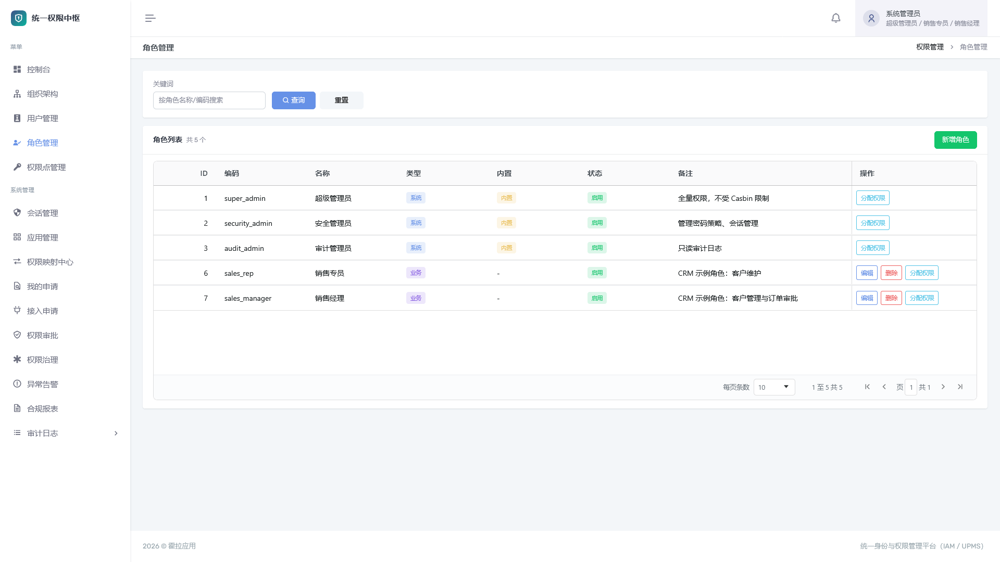

> 图：角色管理

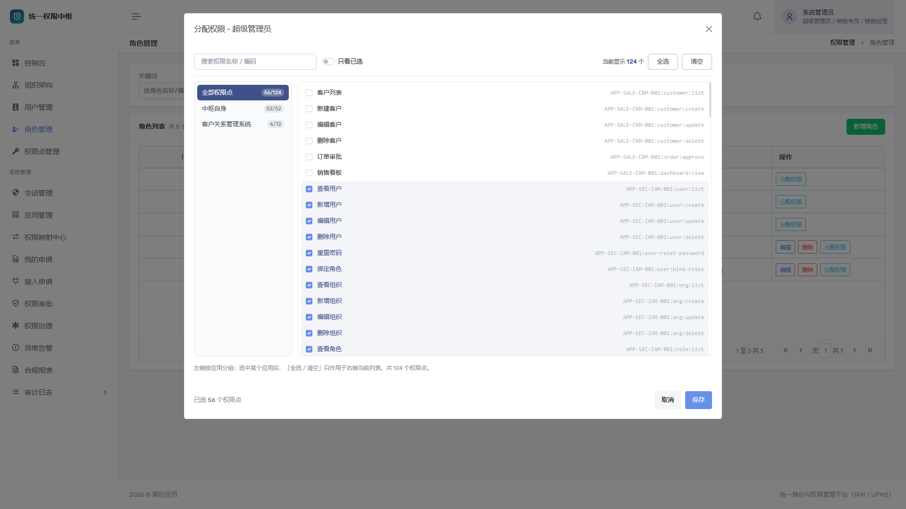

> 图：按应用分组分配权限点

### 4.6 权限点建档

1. **权限点管理** → 选择所属应用 → **新增权限点**；
2. 填写编码 `项目编码:资源:操作`、名称、类型、路由与方法、上级节点；
3. 编码规范：资源用名词、操作用动词（`customer:list`、`order:approve`），同应用内不可重复，前缀必须等于项目编码。

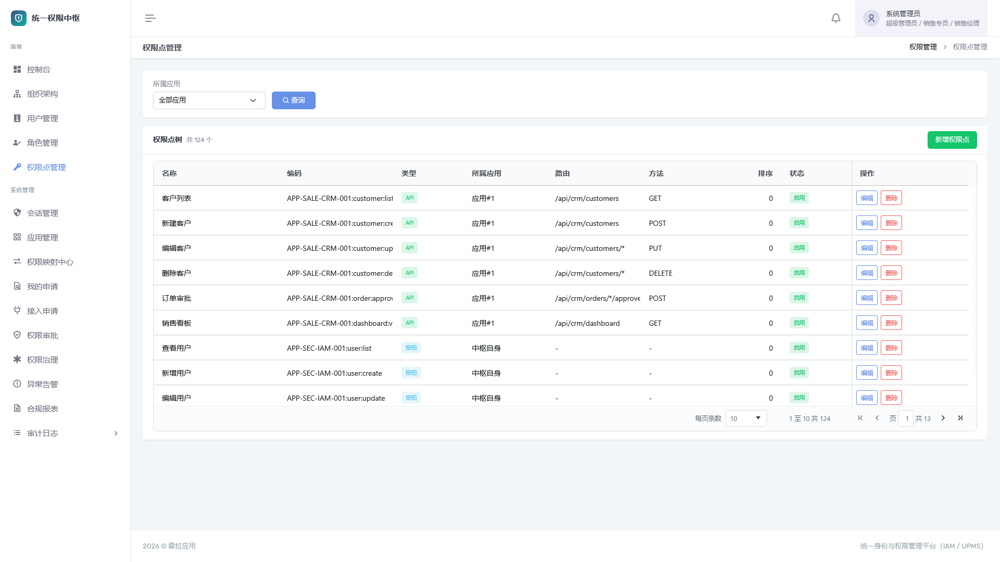

> 图：权限点管理

### 4.7 应用管理

1. **注册应用**：项目编码、名称、负责人、SSO 回调地址（可留空后续补）；
2. 弹窗一次性展示 AppKey / AppSecret / client_id / client_secret，通过安全渠道交付；
3. **应用信息**集中展示基本信息、凭据、SSO 客户端、权限点清单与角色授权；
4. **导出对接信息**：下载 Markdown 文档，可勾选包含密钥（需权限并记审计）；
5. **停用**后该应用所有鉴权请求被拒绝，重新启用即恢复。

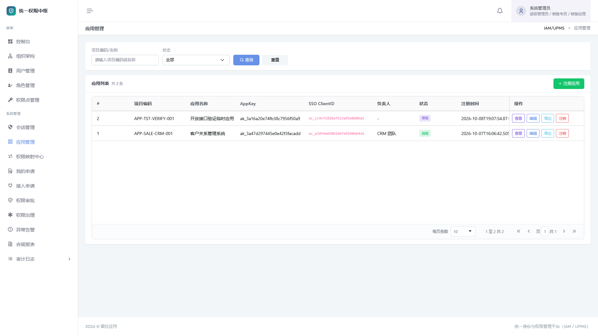

> 图：应用管理

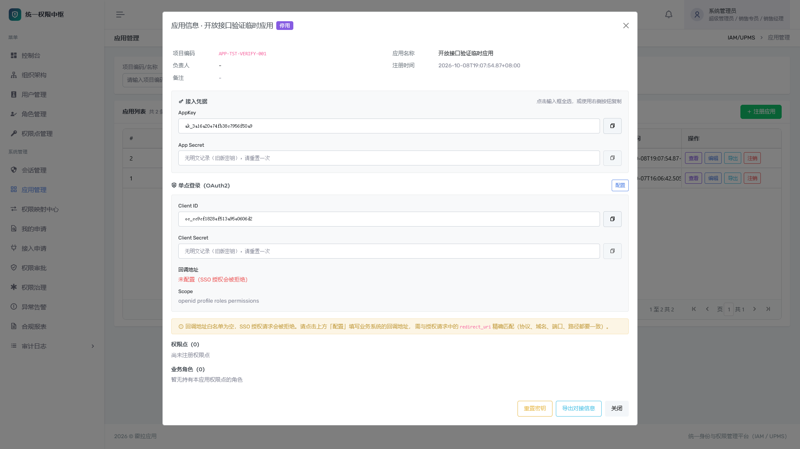

> 图：应用信息（凭据 / SSO 客户端 / 权限点授权）

### 4.8 申请与审批

- 用户：**我的申请 → 新增申请**，选择角色、所属组织、数据范围、有效期（可选）与理由；待审批可撤回，同一角色不可重复申请。
- 管理员：**权限审批** 查看待审批列表，批准自动写绑定，拒绝须填写理由。
- 接入申请：申请人在 **接入申请 → 我的接入申请** 提交；审批人在 **接入审批** 批准，批准后凭据一次性展示。

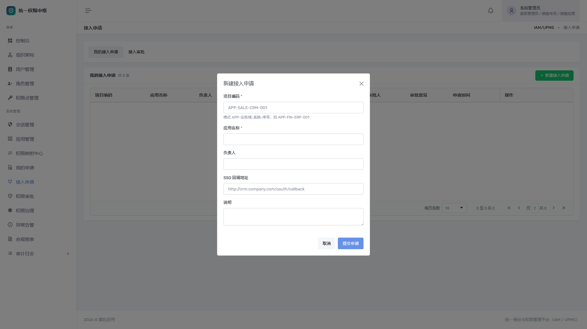

> 图：权限审批

### 4.9 治理、报表与日常运维

| 子功能 | 使用方式 | 建议频率 |
| --- | --- | --- |
| 权限模拟 | 选择用户 + 应用，查看生效权限及来源角色 | 随时 |
| 孤儿权限 | 扫描失效授权，确认后清理 | 每月 |
| 定期复核 | 列出超期未复核授权，批量标记 | 每季度 |
| 日志防篡改 | 校验哈希链，断链立即排查 | 每月 + 事件后 |
| 智能建议 | 查看回收 / 复核建议，人工确认后执行 | 每季度 |

报表用途：用户权限总览（某人有哪些权限）、角色成员统计（某角色有谁）、高风险权限（敏感权限持有者）、审计导出（交付内审）。

日常节奏：每日看告警与待审批；每周核对新增账号与在线会话；每月孤儿清理、完整性校验、备份验证；人员变动当天冻结并回收角色。

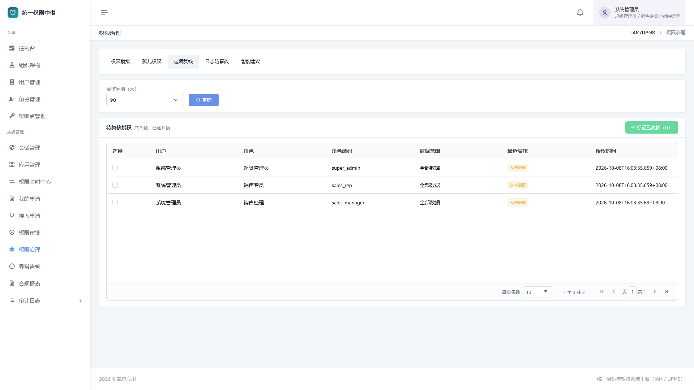

> 图：权限治理（五个 Tab）

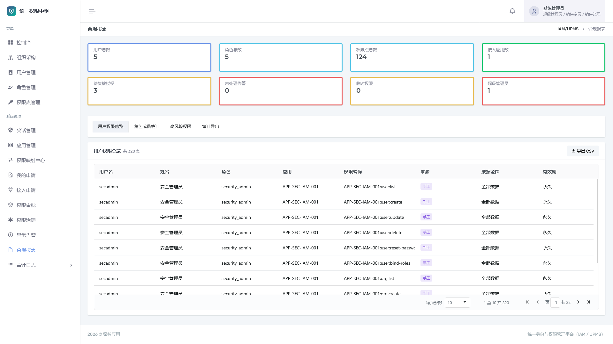

> 图：合规报表

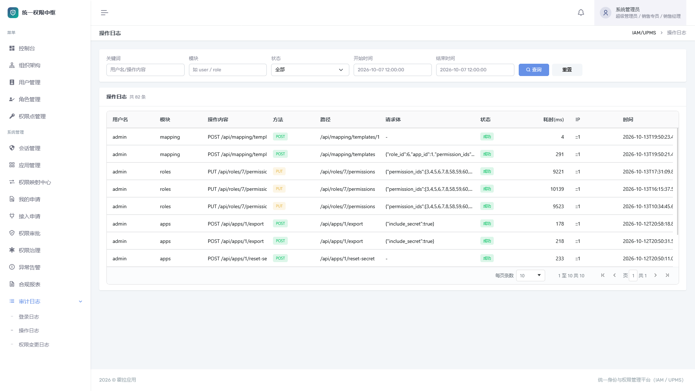

> 图：审计日志

---

## 五、应用接入

### 5.1 接入步骤

| 步骤 | 内容 | 责任方 |
| --- | --- | --- |
| 1 | 注册应用，获取 AppKey / AppSecret / client_id / client_secret | 管理员或自助申请 |
| 2 | 注册本应用权限点（API 类型） | 接入方（可自动注册） |
| 3 | 设计业务角色并授权 | 双方 |
| 4 | 绑定用户与数据范围 | 中枢管理员 |
| 5 | 服务端接入鉴权接口 | 接入方 |
| 6 | 接入 SSO（可选但推荐） | 接入方 |

### 5.2 注册应用与凭据

- 管理端：**应用管理 → 注册应用**；自助：**接入申请** 审批后自动建应用与客户端。
- AppSecret / client_secret 采用明文 + SHA-256 哈希双存，可在应用信息中回读；
- 重置为显式动作，重置后旧密钥立即失效，需同步更新接入方配置；
- 一个应用对应一个 OAuth 客户端，可配置多个回调地址（逗号分隔，精确匹配）。

### 5.3 注册权限点

编码格式 `项目编码:资源:操作`，类型必须为 API（`type=3`）。

**手工建档**：权限点管理 → 选择应用 → 新增，填写编码、名称、类型、路由与方法。

**自动注册（推荐）**：接入方用自身凭据调用，幂等、无需重启：

```
POST /api/open/permissions
```

```json
{
  "permissions": [
    { "code": "APP-SALE-CRM-001:contract:list", "name": "合同查看", "type": 3 },
    { "code": "APP-SALE-CRM-001:contract:create", "name": "合同新建", "type": 3 }
  ]
}
```

```json
{
  "code": 0,
  "message": "ok",
  "data": {
    "created": 2,
    "exists": 0,
    "items": [
      { "code": "APP-SALE-CRM-001:contract:list", "id": 1024, "status": "created" },
      { "code": "APP-SALE-CRM-001:contract:create", "id": 1025, "status": "created" }
    ]
  }
}
```

- 只能注册本应用编码前缀下的权限点，跨应用整批拒绝（403）；
- 编码为空或 type 非 3 → 400；
- 有新建时触发全量策略同步。

### 5.4 统一鉴权接口

```
POST http://<aegis-host>:8080/api/authz/check
```

**请求头**

| Header | 必填 | 说明 |
| --- | --- | --- |
| `X-App-Key` | 是 | 应用 AppKey |
| `X-Timestamp` | 是 | Unix 秒，与服务端偏差 ≤ ±300 秒 |
| `X-Nonce` | 是 | 随机串，5 分钟内不可重复 |
| `X-Signature` | 是 | 十六进制小写 HMAC-SHA256 |

**签名算法**

```
message     = timestamp + "\n" + nonce + "\n" + 请求体原文
hmac_key    = SHA256(AppSecret) 的十六进制字符串（小写）
X-Signature = Hex( HMAC-SHA256(key = hmac_key, message) )
```

> 用 `SHA256(secret)` 而非明文作 key：服务端只存哈希，明文永不落库，同时能完成校验。

**请求体**

```json
{
  "user": "zhangsan",
  "resource": "order",
  "action": "approve",
  "include_scope": true
}
```

| 字段 | 必填 | 说明 |
| --- | --- | --- |
| `user` | 是 | 用户名，或 `"u42"` 形式的中枢用户 ID |
| `resource` | 是 | 权限点编码第二段 |
| `action` | 是 | 权限点编码第三段 |
| `include_scope` | 否 | 为 `true` 且鉴权通过时返回数据范围 |

**响应**

```json
{
  "code": 0,
  "message": "ok",
  "data": {
    "allow": true,
    "reason": "",
    "scope": {
      "all": false,
      "self_only": false,
      "visible_org_ids": [1, 3, 7],
      "data_scope": 2,
      "org_path": [1, 3]
    }
  }
}
```

- `code=0` 表示**接口调用成功**，业务结果看 `data.allow`；
- `allow=false` 时 `reason` 为：`无权限` / `用户已冻结或离职` / `用户不存在`；
- 凭据 / 签名 / 时间窗 / nonce 失败返回 401 与 `40100`，不产生鉴权日志；
- 每次判定写入 `authz_logs`（含哈希链）。

**PowerShell 联调脚本**

```powershell
function Sha256Hex([string]$s) {
    $sha = [System.Security.Cryptography.SHA256]::Create()
    ([BitConverter]::ToString($sha.ComputeHash([Text.Encoding]::UTF8.GetBytes($s))) -replace "-","").ToLower()
}

$appKey = "ak_xxxxxxxxxxxxxxxxxxxx"
$secret = "你的AppSecret"
$ts     = [DateTimeOffset]::UtcNow.ToUnixTimeSeconds().ToString()
$nonce  = [Guid]::NewGuid().ToString("N")
$body   = '{"user":"zhangsan","resource":"order","action":"approve","include_scope":true}'

$message = $ts + "`n" + $nonce + "`n" + $body
$hmac    = [System.Security.Cryptography.HMACSHA256]::new([Text.Encoding]::UTF8.GetBytes((Sha256Hex $secret)))
$sig     = ([BitConverter]::ToString($hmac.ComputeHash([Text.Encoding]::UTF8.GetBytes($message))) -replace "-","").ToLower()

Invoke-RestMethod -Uri http://127.0.0.1:8080/api/authz/check -Method Post `
  -Headers @{ "X-App-Key"=$appKey; "X-Timestamp"=$ts; "X-Nonce"=$nonce; "X-Signature"=$sig } `
  -ContentType "application/json" -Body $body
```

**联调简单模式**（中枢设 `AEGIS_AUTHZ_PLAIN=1` 并重启，生产禁用）：

```powershell
Invoke-RestMethod -Uri http://127.0.0.1:8080/api/authz/check -Method Post `
  -Headers @{ "X-App-Key"=$appKey; "X-App-Secret"=$secret } `
  -ContentType "application/json" -Body $body
```

接口调试入口：`http://<aegis-host>:8080/swagger/index.html`。

### 5.5 数据范围（行级隔离）

鉴权回答"能不能做"，数据范围回答"能看哪些"，开启 `include_scope` 一次拿到。

| 字段 | 用途 |
| --- | --- |
| `all` | `true` 表示不受限 |
| `self_only` | `true` 表示只看本人负责的数据 |
| `visible_org_ids` | **过滤权威值**，可见组织集合（已按组织树展开） |
| `data_scope` | 1 全部 / 2 本组织及下级 / 3 本组织 / 4 仅本人，**仅展示** |
| `org_path` | 用户主组织从根到当前的 ID 链，**仅展示 / 下钻** |

**拼查询条件的唯一正确方式**

1. `scope.all == true` → 不加任何过滤；
2. 否则 `org_id IN scope.visible_org_ids`；若 `self_only == true`，可叠加 `owner_user_id = 当前用户`；
3. `all=false` 且 `visible_org_ids` 为空且 `self_only=false` → **返回空集**，绝不能退化为不过滤。

业务表需预留 `owner_user_id`（中枢用户 ID，即 `sub` 去掉 `u` 前缀）与 `org_id`（中枢组织 ID）两列。

### 5.6 开放接口（应用级）

与鉴权接口共用同一套签名协议，无需用户登录态，同样限流 100 次/秒/AppKey。

**角色成员反查**（会签 / 多级审批"按角色找人"）

```
POST /api/open/role/members
```

```json
// 请求
{ "role": "sales_director" }

// 响应
{
  "code": 0,
  "message": "ok",
  "data": {
    "role": "sales_director",
    "role_name": "销售总监",
    "count": 2,
    "user_ids": [12, 18],
    "real_names": ["李四", "王五"],
    "users": [
      { "user_id": 12, "username": "lisi", "real_name": "李四", "org_id": 3 },
      { "user_id": 18, "username": "wangwu", "real_name": "王五", "org_id": 3 }
    ]
  }
}
```

只返回在职成员（冻结 / 离职自动剔除）；角色不存在或已停用返回 404。

---

## 六、单点登录

中枢作为 **IdP**，接入应用作为 **RP**，采用 OAuth2 授权码模式（OIDC 简化）。

### 6.1 流程

```
用户访问 CRM
  → CRM 重定向：GET {中枢}/api/oauth/authorize
        ?client_id=oc_xxx&redirect_uri=https://crm.example.com/callback
        &response_type=code&scope=openid profile&state=xxx
  → 中枢：未登录 → 302 到 {AEGIS_CONSOLE_URL}/login?redirect=<当前授权地址>
          已登录 → 直接下发 code
  → 中枢 302 回：redirect_uri?code=xxx&state=xxx
  → CRM 服务端：POST {中枢}/api/oauth/token
        grant_type=authorization_code&code=xxx&client_id=...&client_secret=...
  → 返回 access_token（60 分钟）
  → CRM 调 GET {中枢}/api/oauth/userinfo（Bearer access_token）
```

> 未登录时的登录页跳转由中枢自动处理，接入方无需额外实现；但 `AEGIS_CONSOLE_URL` 必须是浏览器可访问的控制台地址。

### 6.2 端点

| 方法 | 路径 | 认证 | 说明 |
| --- | --- | --- | --- |
| GET | `/api/oauth/authorize` | 登录态（Bearer 或 `?access_token=`） | 下发授权码，未登录跳登录页 |
| POST | `/api/oauth/token` | client_id + client_secret | 授权码换 access_token（表单或 query） |
| GET | `/api/oauth/userinfo` | Bearer access_token | 用户身份、角色、权限、数据范围 |
| GET | `/api/oauth/clients` | 登录 + 管理权限 | 客户端列表 |
| PUT | `/api/oauth/clients/:id` | 登录 + 管理权限 | 配置回调地址 / scope / 状态 |
| POST | `/api/oauth/clients/:id/reset-secret` | 登录 + 管理权限 | 重置 client_secret |

**令牌响应**

```json
{
  "code": 0,
  "message": "ok",
  "data": {
    "access_token": "eyJhbGciOi...",
    "token_type": "Bearer",
    "expires_in": 3600,
    "scope": "openid profile roles permissions"
  }
}
```

**userinfo 响应**

```json
{
  "sub": "u1",
  "username": "zhangsan",
  "real_name": "张三",
  "email": "",
  "phone": "",
  "org_id": 1,
  "data_scope": 2,
  "org_path": [1, 3],
  "visible_org_ids": [1, 3, 7],
  "roles": ["sales_manager"],
  "role_names": ["销售经理"],
  "permissions": ["APP-SALE-CRM-001:customer:list", "APP-SEC-IAM-001:user:list"]
}
```

> **重要**：`permissions` 返回该用户**全部** API 权限点（含中枢自身），接入方必须按本应用项目编码前缀过滤后再使用。

### 6.3 关键约束

| 项 | 约束 |
| --- | --- |
| `redirect_uri` | 必须与白名单**精确匹配**（协议、域名、端口、路径、末尾斜杠） |
| 授权码 | 一次性、5 分钟有效、绑定 client_id |
| access_token | 60 分钟有效，可复用；登出或停用应用后自然过期 |
| state | 原样回传，接入方应校验防 CSRF |
| 授权页 | 内部系统首版免同意页，自动授权 |
| 回调配置 | 应用管理 → 查看 → 单点登录 → 配置；注册时填写的回调地址即初始白名单 |

### 6.4 上线前自检

- [ ] 应用状态启用，凭据存放在配置中心（不硬编码、不进代码库）
- [ ] 回调地址与授权请求完全一致
- [ ] 所有受控接口都调用 `/authz/check`，无"前端隐藏按钮即视为已鉴权"的漏洞
- [ ] 行级隔离按 `scope` 三值语义拼接，空集不退化为全量
- [ ] `userinfo.permissions` 已按本应用前缀过滤
- [ ] 服务端时间已同步（NTP）
- [ ] 生产环境 `AEGIS_AUTHZ_PLAIN` 已关闭
- [ ] 鉴权路径已压测，确认限流阈值够用

---

## 七、接口错误码

统一响应：`{ code, message, data }`。

| 场景 | HTTP | code | 处理建议 |
| --- | --- | --- | --- |
| 成功 | 200 | 0 | 看业务字段（如 `data.allow`） |
| 未认证 / 凭据签名错误 / 时间窗超限 / nonce 重放 | 401 | 40100 | 核对凭据与签名算法、服务器时间 |
| token 过期 | 401 | 40101 | 重新登录或刷新 |
| token 无效 | 401 | 40102 | 重新登录 |
| 无权限 | 403 | 40300 | 权限不足，走申请流程 |
| 参数错误 | 400 | 40000 | 检查必填字段 |
| 密码错误 | 400 | 40001 | 重新输入或重置 |
| 用户冻结 / 离职 | 400 | 40002 | 联系管理员 |
| 用户不存在 | 400 | 40003 | 核对用户名 |
| 名称 / 编码冲突 | 400 | 40004 | 更换编码 |
| 资源不存在 | 404 | 40400 | 检查应用 / 角色 / 客户端 ID |
| 服务端错误 / 限流 | 500 / 429 | 50000 | 退避重试，联系运维 |

---

## 八、运维与安全

### 8.1 资源规划

| 规模 | 用户数 | 建议配置 |
| --- | --- | --- |
| 小 | < 500 | 2 核 / 4 GB / 50 GB |
| 中 | 500 ~ 5000 | 4 核 / 8 GB / 100 GB |
| 大 | > 5000 | 8 核 / 16 GB / 200 GB，数据库独立部署并归档审计表 |

审计类表（登录 / 操作 / 鉴权日志）随访问量线性增长，是主要增长源；建议对超保留期数据归档导出后清理。

### 8.2 密钥管理

| 密钥 | 位置 | 轮换方式 | 影响 |
| --- | --- | --- | --- |
| JWT Secret | `.env` → `AEGIS_JWT_SECRET` | 修改后 `docker compose up -d` | 全体会话失效 |
| MySQL 密码 | `.env` | 需同步修改数据库内账号密码 | 后端连接失败 |
| 应用 AppSecret | 应用信息 | 重置密钥 | 该应用鉴权调用立即失败 |
| OAuth ClientSecret | 应用信息 → 单点登录 | 重置 ClientSecret | 该应用换 token 失败 |

- 密钥全部由部署脚本随机生成，长度 ≥ 32 位；
- 不通过聊天工具明文传递；接入方凭据放配置中心，禁止入库；
- 出现泄露迹象立即轮换，并核查审计日志；
- **存量提示**：早期签发的应用密钥仅有哈希，重置一次即建立明文基线。

### 8.3 监控与日志

| 监控项 | 方式 |
| --- | --- |
| 存活 | `GET /api/health` 返回 `code=0`，建议每 30s 探测 |
| 容器 | `docker compose ps`、重启次数 |
| 资源 | `docker stats` |
| 应用日志 | `docker compose logs -f backend` |
| 业务审计 | 审计日志、异常告警、合规报表 |

容器日志建议配置轮转（`json-file` 的 `max-size=50m`、`max-file=5`）；磁盘使用率超 80% 告警。

### 8.4 安全加固清单

| # | 项 | 说明 |
| --- | --- | --- |
| 1 | 修改全部默认口令 | 部署后第一件事 |
| 2 | 收敛端口暴露 | 仅 3000（或前置反代）对外，8080 / 3307 限制内网 |
| 3 | 启用 HTTPS | 在 nginx 前做 TLS 终结，避免口令与 token 明文传输 |
| 4 | 校正 `AEGIS_CONSOLE_URL` | 必须是浏览器可访问的真实地址 |
| 5 | 关闭 Swagger | 生产设 `AEGIS_SWAGGER=0` |
| 6 | 关闭简单模式 | 确认 `AEGIS_AUTHZ_PLAIN` 未开启 |
| 7 | 落实三权分立 | 三个内置角色由不同人持有 |
| 8 | 定期轮换密钥 | 按周期或事件驱动 |
| 9 | 审计留痕 | 不删改日志，定期做哈希链校验 |
| 10 | 操作系统加固 | 关闭无关端口、限制 SSH 来源、及时打补丁 |

**代码保护边界（如实说明）**：后端经 garble 混淆并裁剪符号，显著提高逆向成本但**不等于不可逆向**；前端为浏览器可执行代码，接口路径与字段仍可见。因此**所有权限判定必须留在后端**（当前架构已满足）。真正的安全边界是：密钥来自环境变量、生产密钥随机化、默认口令首登即改、最小权限授权。

### 8.5 故障速查

| 现象 | 排查方向 |
| --- | --- |
| 页面打不开 | 前端容器与端口映射、防火墙 |
| 健康检查 502 | 后端未就绪或崩溃，看后端日志 |
| 登录后立即 401 | JWT Secret 被改，或时间严重偏差 |
| 大量用户被登出 | 是否更换了 `AEGIS_JWT_SECRET` |
| 鉴权全部拒绝 | 应用是否停用、权限点是否为 API、用户是否冻结 |
| 签名失败 | 时间窗、nonce 重复、message 拼接顺序、secret 是否已重置 |
| SSO 回调错误 | 回调地址与白名单是否精确一致 |
| SSO 跳转 404 | `AEGIS_CONSOLE_URL` 指向了 8080 而非控制台前端 |
| 磁盘持续增长 | 审计表数据量、容器日志未轮转 |
| MySQL 启动失败 | 数据卷损坏或密码被改，恢复备份 |

### 8.6 应急响应

| 事件 | 处置顺序 |
| --- | --- |
| 管理员账号疑似泄露 | 强制下线 → 重置密码 → 核查审计日志 → 轮换 JWT Secret |
| 应用密钥泄露 | 重置 AppSecret / ClientSecret → 通知接入方 → 核查 `authz_logs` |
| 误删角色 / 用户 | 从最近备份恢复，评估期间审计完整性 |
| 权限异常扩大 | 孤儿权限 + 高风险报表定位 → 收权 → 复盘审批记录 |
| 日志疑似被篡改 | 日志防篡改校验断点，结合备份比对 |
| 主机失陷 | 断网隔离 → 保留现场 → 干净环境恢复备份 → 全量轮换密钥口令 |

---

## 九、常见问题

**部署**

- **目标机需要联网吗？** 不需要，镜像全离线；运行期也无外网依赖。
- **需要 Go / Node 吗？** 不需要，目标机只需 Docker；构建发布包时才需要。
- **支持哪些系统？** Linux x86_64（推荐）、Windows / macOS（Docker Desktop）。镜像为 `linux/amd64`。
- **启动卡在 mysql waiting？** 首次初始化 30s+ 属正常，看 `docker logs aegis-mysql`。
- **升级会丢数据吗？** 不会，数据在卷中，启动自动迁移；升级前仍建议备份。
- **能部署多套吗？** 可以，每套独立目录、卷与端口，`AEGIS_CONSOLE_URL` 各自对应。

**账号与登录**

- **默认账号？** `admin` / `Admin@123456`，另有 `secadmin`、`auditadmin`，均首登强制改密。
- **忘记 admin 密码？** 由其他超管重置；唯一超管丢失时用备份恢复或联系交付团队。
- **登录后立刻被踢回？** JWT Secret 变更或服务器时间偏差。
- **支持 LDAP / 企业微信 / MFA 吗？** v1.0.0 均不支持。
- **冻结用户的会话怎么办？** 鉴权接口对其直接拒绝，管理中心可同时强制下线。

**权限与鉴权**

- **加了角色但菜单看不到？** 检查权限点是否分配、是否**退出后重新登录**（前端权限码登录时缓存）、数据范围是否覆盖、编码前缀是否正确。
- **建档成功但鉴权恒拒绝？** 权限点类型不是 API（`type=3`）。
- **签名一直失败？** 依次检查：`hmac_key` 是否为 `SHA256(secret)` 十六进制小写、message 是否为 `ts + "\n" + nonce + "\n" + body`、body 是否为原始字节、时间戳偏差、secret 是否重置、签名是否小写。
- **nonce 重放？** 同一 nonce 5 分钟只能用一次，重试需重新生成。
- **返回 429？** 限流 100 次/秒/AppKey，做退避重试或合并判定。
- **`visible_org_ids` 为空是不限制吗？** **不是**，代表无可见数据；只有 `all=true` 才不过滤。
- **`data_scope` 能拼 SQL 吗？** 不能，只能用于展示；过滤用 `visible_org_ids` + `self_only`。
- **多角色数据范围怎么算？** 取最宽，并按组织树展开。
- **删角色后用户绑定还在吗？** 可能残留，用「孤儿权限」扫描清理。

**接入与 SSO**

- **AppSecret 关闭弹窗还能看吗？** 可以，应用信息中回读；早期密钥需重置一次。
- **重置密钥影响什么？** 旧密钥立即失效，接入方需同步更新。
- **回调地址不在白名单？** 必须完全一致（含端口与末尾斜杠），多个用英文逗号分隔。
- **SSO 未登录跳 404？** `AEGIS_CONSOLE_URL` 配置成了后端地址或不可访问地址。
- **`permissions` 里有别的应用？** 设计如此，按本应用前缀过滤。
- **token 能刷新吗？** 无 refresh 机制，过期重新走授权码流程。
- **授权码能复用吗？** 不能，一次性 5 分钟；服务重启后未使用的失效。
- **支持 SAML / CAS 吗？** 不支持，仅 OAuth2 授权码模式简化实现。

**运维**

- **审计日志能删吗？** 前端不提供删除；哈希链可检出篡改，超期数据建议导出归档后由运维处理。
- **支持集群 / 高可用吗？** 不支持，单实例定位，依赖备份与快照。
- **怎么查版本？** 看发布包 `BUILD-INFO.txt` 或 `docker images | grep aegis-iam`。

---

## 十、版本记录

### v1.0.0 — 2026-10-12

首个正式对外发布版本，定位单实例私有化部署的统一身份与权限中枢。

**新增**

- 组织树（集团 / 公司 / 部门 / 团队）、用户全生命周期管理、数据范围四档
- 三权分立内置角色 + 自定义业务角色，权限点分菜单 / 按钮 / API 三类
- Casbin 统一鉴权接口，AppKey + HMAC 签名 + 防重放 + 限流
- 数据范围随鉴权下发，支持应用侧行级隔离
- 应用注册与凭据管理、密钥明文 + 哈希双存、对接文档导出
- 权限点自注册、角色成员反查开放接口
- OAuth2 授权码 SSO，`userinfo` 返回身份、角色、权限与数据范围
- 权限映射中心（模板预览 / 同步 / 撤销 / 启停 / 日志）
- 权限申请与接入申请两套审批流
- 权限治理（模拟 / 孤儿 / 复核 / 防篡改 / 建议）、合规报表、异常告警
- 登录 / 操作 / 变更日志与哈希链完整性校验、会话管理
- 离线 Docker 镜像包、一键部署脚本、同源反代、Swagger UI
- 后端 garble 混淆（标识符 + 字符串字面量）、符号与路径裁剪

**安全说明**

- 默认账号首登强制改密；生产密钥随机生成、不入镜像
- 前端仅做展示，权限判定全部在后端完成

**已知限制**

- 仅支持单实例，不支持多活 / 集群
- 不支持 MFA、外部 IdP 对接、字段级权限与自定义 ABAC
- OAuth2 为 OIDC 简化实现，不提供发现文档与 id_token
- 审计日志不自动清理，需制定归档策略

---

## 十一、许可与支持

**许可**

版权所有 © 无锡跳蚤文化传媒有限公司。保留所有权利。

AEGIS 为**闭源商业软件**，本仓库仅发布产品文档与安装包，**不构成任何开源许可**，也不授予源代码相关权利。

在取得正式书面授权的前提下，被授权方可在授权约定的组织范围与部署数量内安装、运行本软件，并依据文档接入自有业务系统。

未经书面许可，不得：复制、传播、公开提供、出售、出租、转让本软件或安装包；反编译、反汇编、逆向工程或试图获取源代码；移除版权标识与许可声明；制作衍生作品或用于商业再分发。

本软件按"现状"提供，除授权合同另有约定外不作适用性、无中断或无错误担保；因未按文档实施（如未改默认口令、未备份数据、错误配置密钥、端口直接暴露公网）造成的损失由使用方自行承担。

本软件包含第三方开源组件，其许可由各自项目规定，不因本声明而改变。

如本声明与正式授权合同冲突，以合同为准。

**支持**

- 产品官网：<https://apps-hub.apphola.com/>
- 文档中心：<https://docs.apphola.com/>
- 问题反馈、技术支持、授权与商务咨询：请通过上述官网或文档中心联系
- 安全问题：请勿在公开渠道披露，通过官网或文档中心提供的联系方式反馈


